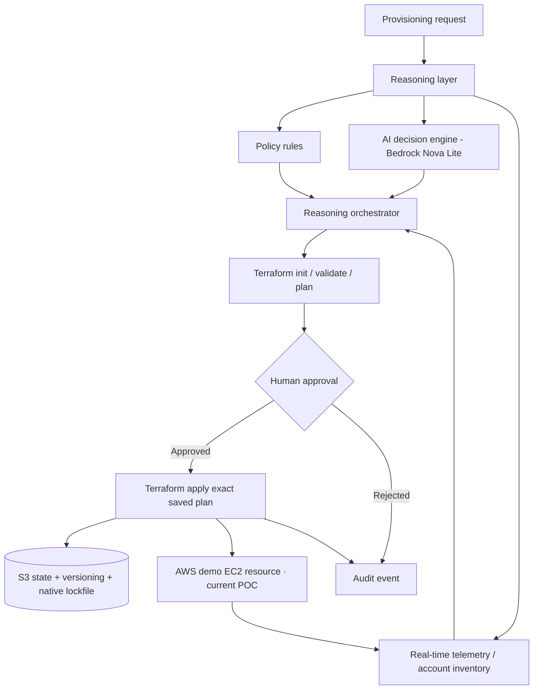

# Intelligent Provisioning Platform (v19)

Connected Clouds now uses compact cards with a single gross MTD usage metric:
[dashboard cleanup and controller access](docs/connected-clouds-cleanup.md).
Credits and net expenditure remain available internally and in account billing.
Earlier billing definitions:
[billing definitions, POC illustrations and live evidence](docs/gross-infrastructure-usage.md).

Current organization, billing, read-role setup and live verification limits:
[Organization billing and account inventory](docs/organization-billing-inventory.md).
This guide supersedes the earlier dashboard layout and configured-account subtotal descriptions.
SSO refresh and actual AWS/runtime/browser results are recorded in the
[2026-11-11 live validation report](docs/aws-live-validation-2026-11-11.md).

The customer POC adds authenticated admin access, a fixed branded header,
AWS/Azure/GCP provider cards, organization details on hover or focus, organization
MTD billing and connected-account subtotals. Account details expand below the cards;
deployment history retains reviewed operations, and successful-source reuse shows
saved CPU/RAM sizing. See [setup, permissions and limits](docs/customer-poc-access.md)
and the [implementation record](docs/customer-poc-implementation.md). These guides
supersede older demo-login and dashboard descriptions below. No IAM policies are
attached and no application deployment is performed by these source changes.

The homepage now provides unified AWS, Azure, and GCP hierarchy exploration,
target inventory and provider billing. See [dashboard configuration and access
boundaries](docs/multicloud-dashboard.md). Configure opens the connection form
directly; Deployment uses bottom-right pagination.

Optional customer-scoped approvals and scheduling are documented in
[Control-plane workflow](docs/control-plane-workflow.md), including identity setup,
worker operation, plan expiry and remaining integrations.

Demo provisioning now supports editing saved-plan inputs, explicit worker counts,
shared comparison tiers and resource success details. See
[behavior and live verification limits](docs/demo-provisioning-verification.md).

The current Agent uses a direct prompt, automatic explanations, three-cloud
Selectable/Recommended/Optimal choices, labelled Terraform inputs, and saved-plan
and approval dialogs for servers and Linux-worker Kubernetes. Work has a compact
controller header with Refresh and no duplicated target inventory panel. See the
[current workflow and runtime requirements](docs/agent-prompt-workflow.md).
Advanced options contain only provider regions. Selectable matches the request;
Recommended and Optimal add successive CPU/RAM upgrades. Terraform inputs include
a matching-provider account selector and account-backed image, network and managed
Kubernetes version choices; see [live inputs and permissions](docs/provider-live-inputs.md).
The v19 release notes below describe the earlier baseline; the current workflow
guide supersedes its UI and new-target execution descriptions. Live cloud
plan/apply validation is still required; execution settings remain off by default.

The extended Linux/Windows POC is available in Agent: requirement confirmation,
OS-specific comparisons, policy evidence, latency imports, illustrative Linux
Kubernetes sizing and multi-cloud Terraform configuration/saved-plan generation.
New-target execution remains disabled pending live validation. See
[coverage and usage](docs/linux-windows-poc.md). The architecture below describes
the preserved v19 workflow.

Terraform-only provisioning · Human approval · Full audit trail.

This release presents the product as **Intelligent Provisioning Platform**, an intelligent multi-cloud provisioning platform from Innominds. Existing EC2 project paths, Docker image/container identifiers, IAM role names and the `innominds-iipp` Secrets Manager namespace remain unchanged as technical compatibility identifiers.

## 1. Scope

The Agent now uses the selected **Agent Workspace (option 04)** design: a request and recommendation column beside decision evidence, AWS/Azure/Google Cloud coverage, and recent audit activity. Kubernetes is shown as planned with execution disabled. The reviewed Terraform workflow is unchanged. See [Agent Workspace UI](docs/agent-workspace-ui.md) for usage, backup, and rollback instructions.

- Product identity **Intelligent Provisioning Platform** appears once in the shared header. The Innominds company logo remains in the left navigation.
- Agent uses one centered infrastructure-request form with a **Find options** action. Provider regions are under **Advanced options**. The separate general-question chat and suggested prompts have been removed; comparison, candidate selection and reviewed Terraform workflows remain available after submission.
- One global top bar shared by Work and Agent with Cloud (AWS/Azure/GCP), account/subscription/project selection and Configure. The selected connection drives both page contexts.
- The full live account inventory and its telemetry panel are rendered in Work only. Agent uses the selected connection as live evidence when answering prompts, without duplicating the inventory UI.
- A one-shot modal Configure dialog with an explicit Close control and a separate one-shot connection-verified success dialog; ordinary page interactions do not reopen either dialog. AWS External IDs are validated before STS calls.
- AWS, Azure and Google Cloud account connection forms; credentials are stored in AWS Secrets Manager, while the local provider registry stores only non-secret metadata and a secret ARN.
- Live inventory checks for AWS, Azure and GCP connections. Failed APIs are surfaced as unavailable; no connected account is silently replaced with demo inventory.
- Live AWS EC2 type/region offering/specification discovery for the selected verified account. No hardcoded AWS instance type fallback..
- Reasoning layer with deterministic policy checks, Amazon Bedrock Nova Lite, live inventory/telemetry and a reasoning orchestrator.
- Terraform-only AWS EC2 demo provisioning. Plan is generated and checksummed, human-reviewed and only the exact saved plan is applied. Agent output is constrained to a short highlighted recommendation, exact/nearest safe hardware fit, evidence and limitations. Internal reasoning tags such as `<thinking>` are stripped before display. Legacy direct EC2 API stop/modify/start resize execution is disabled; the current stack creates a new demo instance and does not import or resize QuickCart.
- Central S3 state backend for new Terraform deployments with versioning and native S3 lockfiles. Terraform is disabled until the S3 bucket is configured.
- Shared Terraform provider plugin cache, mounted persistently and protected by a global `terraform init` lock.
- Administrator-run bootstrap scripts for AWS Organizations, restricted target IAM roles, and monthly budget alerts. The current user environment already has Demo-Account (`333347372766`) and Test-Account (`695729002971`) under IIPP-Sandbox; do not rerun account-creation scripts for those accounts.

**Provider maturity:** AWS is the first end-to-end provisioning provider in this POC. Azure and GCP Configure forms and live inventory checks are included, but their Terraform provisioning stacks are not implemented in v18. Their comparison price rows remain public-catalogue reference estimates and must not be described as live capacity.

**Explicit exclusions:** Kubernetes and GitOps are not part of this architecture or release.

## Live AWS price verification (v18)

For each new Agent comparison, Intelligent Provisioning Platform clears its prior result and price cache, then queries AWS Price List Query API (`AmazonEC2:GetProducts`) for the current Linux/shared On-Demand hourly rate for shortlisted EC2 types in the selected AWS region. The UI shows the rate source and actual UTC fetch time; the Agent explanation receives that exact price and timestamp. Failed or ambiguous lookups are never replaced with fixture values.

Public On-Demand compute estimate = hourly rate × 730 hours. It excludes EBS, data transfer, public IPv4, taxes, support, Savings Plans, Reserved Instance benefits, Spot pricing and account-specific discounts/credits. It is an estimate, not the final account bill. The Price List call runs under the management-account EC2 controller role and requires `pricing:GetProducts`; target inventory roles continue to provide EC2 type/region evidence. See [`docs/aws-live-pricing.md`](docs/aws-live-pricing.md).

## 2. Corrected architecture

The supplied original architecture image remains available at `assets/reference-architecture-original.png`. This release intentionally omits Kubernetes and GitOps. The expanded architecture and provider maturity matrix are in [`docs/architecture.md`](docs/architecture.md).

## 3. Repository map

| Area | Files | Purpose |
|---|---|---|
| Dashboard | `app.py`, `provider_ui.py` | Work, Agent, global Configure panel |
| Provider secrets and discovery | `provider_connections.py` | Secrets Manager, STS, Azure Resource Manager and GCP Compute inventory |
| Cloud comparison and pricing | `cloud_comparison.py`, `cloud_adapters/`, `aws_data.py` | Live AWS EC2 discovery, AWS Price List Query API pricing and clearly labelled public Azure/GCP price references |
| Policy | `policy_engine.py`, `policy_templates/aws/iipp-policy.json` | Deterministic non-production provisioning guardrails |
| Terraform orchestration | `terraform_service.py` | S3 init, validate, plan, approval, apply and destroy workflow |
| Terraform template | `terraform/stacks/aws_demo/` | Reviewed AWS EC2 POC stack, private IP disabled, encrypted gp3 root volume |
| AWS setup | `scripts/create_iipp_test_accounts.py`, `scripts/configure_iipp_test_accounts.py` | Separate accounts, roles and budget notifications |
| S3 and IAM | `scripts/bootstrap_iipp_state_bucket.sh`, `scripts/generate_iipp_controller_policy.py` | Versioned state bucket and least-privilege controller policy |
| Deployment | `backup.sh`, `deploy.sh`, `rollback.sh`, `cleanup.sh` | Backup, safe Docker deployment and rollback |

## 4. AWS account model

The current controller account (Naresh-Acc, `704298683641`) hosts the EC2 controller and is intended to host the central S3 state bucket after an administrator creates it. The user's existing member accounts are Demo-Account (`333347372766`) for POC and Test-Account (`695729002971`) for TEST; both are reported under the `IIPP-Sandbox` OU. The account-creation script is optional for a future environment and must not be rerun for these existing accounts. Each target account receives:

- `IIPPInventoryReadRole`: read-only inventory, CloudWatch, quotas and cost visibility.
- `IIPPTerraformExecutionRole`: restricted launch/terminate permission for IIPP-tagged `t3.*` instances in the selected region and only in POC/TEST.

The controller role assumes the target roles using unique External IDs. The S3 backend always uses the controller identity; the AWS Terraform provider assumes the selected target execution role. No target account needs access to the central S3 bucket.

See [`docs/aws-account-bootstrap.md`](docs/aws-account-bootstrap.md) for commands and required management-account permissions. Account creation and IAM changes must be run by an authorized AWS management-account administrator; this ZIP cannot grant its own IAM permissions.

## 5. Terraform state and cache

New Terraform deployments use a unique S3 key:

`iipp/deployments/<deployment-id>/terraform.tfstate`

The S3 backend is initialized with `use_lockfile=true`; bucket versioning is enabled by the bootstrap script. Provider binaries are reused from `/opt/cloudpilot/terraform-plugin-cache`, mounted into Docker. The service serializes `terraform init` operations because the Terraform plugin cache is not concurrency-safe. It removes regenerable per-deployment `.terraform/` working directories after saving plans and after apply/destroy, then reinitializes the same S3 backend using the retained provider lock file before approval/apply. This keeps the large provider working copy out of idle deployment folders.

The immediate EC2 disk cleanup was completed before this release: the reported root volume use dropped to 21%, 27 GB became available, all existing 18 state files were preserved and all historical `.terraform` working directories were removed. v18 does not migrate or delete those legacy states. Only new deployments use S3. See [`docs/terraform-state-and-cache.md`](docs/terraform-state-and-cache.md).

## 6. Deployment is disabled until prerequisites are complete

- `ENABLE_TERRAFORM_WORKFLOW=false` by default.
- `ENABLE_APPROVAL_EXECUTION=false` by default.
- The Terraform service refuses to create new deployments without `TF_STATE_BUCKET`.
- The Terraform plan selector only accepts a tested AWS connection containing both target-account roles.
- The current EC2 controller role must be granted S3 state access, Secrets Manager access and `sts:AssumeRole` to the two target accounts.
- Port 8501 must be restricted to an authorized reviewer/demo IP range before any write workflow is enabled.

The EC2 deployment guide for this UI update is [`docs/deploy-v18.md`](docs/deploy-v18.md). It uses a staging folder and overlays the release into the existing EC2 checkout without deleting `.env`, `/opt/cloudpilot/data`, existing Terraform state, or prior Docker images.

## 7. Manager demo flow and verification

- Select AWS → Demo-Account or Test-Account in the top bar; Work and Agent use the same selection.
- Configure opens in a modal; successful test/save is followed by a separate success dialog.
- Ask Agent for a concise exact/nearest safe CPU/RAM recommendation based on live AWS inventory and regional offerings.
- Resource creation is planned in Agent; after apply, Work lists the deployment. Work routes destroy-plan preparation to Agent, then displays the saved destroy plan for final approval.

## 8. Verification and limitations

- Unit tests cover Terraform plan/apply guardrails, target-account policies, remote state initialization parameters, provider inventory behavior and the existing comparison/recommendation logic.
- No AWS Organizations accounts, IAM roles, budgets, S3 bucket or live provider connections are created by the ZIP build itself.
- No real Terraform plan/apply/destroy was run by the local build environment.
- Live Bedrock calls, Secrets Manager permissions, STS AssumeRole, S3 backend access, Azure/GCP SDK authentication and the full Streamlit rendering must be validated on the backed-up EC2 host after IAM setup.
- The account budget thresholds are notifications, not hard cost caps.

After a resource is created in Agent, Work lists the provisioned resource. A user can request Agent to prepare a destroy plan, then return to Work to review and approve the saved destroy plan. Destroy is never applied during plan preparation. See [`UPDATE-NOTES-v18.md`](UPDATE-NOTES-v18.md), [`IMPLEMENTATION_STATUS.md`](IMPLEMENTATION_STATUS.md) and [`VERSION-COMPARISON.md`](VERSION-COMPARISON.md) for implementation details and remaining live steps.

## v18 recommendation and Agent experience

- Deterministic recommendation now prioritizes an eligible exact hardware match; if none exists, only options meeting both requested CPU and RAM minimums can be recommended.
- Within the preferred hardware-fit tier, the selected strategy ranks available USD compute prices, workload fit and verified availability evidence. Comparable measured end-to-end latency is included only when present; otherwise no latency winner is claimed.
- The cost-optimal option is reported separately as the lowest-priced eligible option in the preferred hardware-fit tier. The comparison table and selector mark Recommended and Optimal choices, and preserve Exact match check and closest configurations, all returned priced eligible options, and Detailed comparison and exclusions.
- The recommendation explanation is automatically generated after the user submits the infrastructure prompt. It is grounded in the deterministic comparison result, targets 6–8 short lines, and is sanitized before Markdown rendering.
- For the supplied 4 vCPU / 9 GiB example, the supplied price evidence ranks AWS `m5a.xlarge` (USD 81.03/month) ahead of `c5n.xlarge` (USD 157.68/month), provided the live AWS regional offering check and current price lookup both succeed. These screenshot values are examples from the user-provided comparison, not a live price guarantee.
- AWS regional offerings do not prove account quota or on-demand spare capacity. Azure/GCP public catalogue prices are not connected-account capacity evidence; the reviewed Terraform apply flow remains AWS-only.

See [`UPDATE-NOTES-v18.md`](UPDATE-NOTES-v18.md) and [`docs/deploy-v18.md`](docs/deploy-v18.md).

Controller IAM policy artifact: [`iam-live-pricing-policy.json`](iam-live-pricing-policy.json). Attach it to `CloudPilotReadTargetMetricsRole` in the management account, not to the Demo/Test inventory roles.
