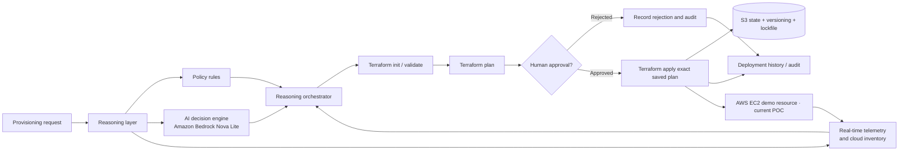

# Intelligent Provisioning Platform — Multi-Cloud Intelligent Provisioning architecture

## Corrected flow (Terraform-only provisioning)

The original image supplied for this project is retained at `assets/reference-architecture-original.png` for traceability. Its Kubernetes and GitOps boxes are intentionally excluded from this release.

## Layer responsibilities

### Reasoning layer

- **Policy rules:** deterministic allow/deny checks execute before a plan is generated. Policies may constrain cloud accounts, regions, resource families, tags, TTL, encryption, public exposure, and budget guardrails.
- **AI decision engine:** Bedrock Nova Lite explains live evidence and proposes a suitable cloud/resource option. The model is advisory and cannot bypass policy or call Terraform directly.
- **Real-time telemetry:** provider adapters query the selected account/subscription/project. API failures remain unavailable; the UI must never substitute mock resources for a live account.
- **Reasoning orchestrator:** correlates user request, inventory, policy result, cost estimate and the AI's rationale, then routes an approved request into the Terraform workflow.

### Provisioning layer

Terraform only: `init` → `validate` → `plan` → human approval → apply the exact saved plan. Destroy is a separate saved plan and separate human approval. Terraform state for new deployments is remote in the central S3 bucket with versioning and native lockfiles.

### Cloud scope in this release

| Provider | Configure credentials | Live account inventory | Terraform resource apply |
|---|---|---|---|
| AWS | Yes | Yes: STS and EC2 sample inventory; EC2 option discovery and reference validation | Yes: reviewed AWS EC2 demo stack only |
| Azure | Yes | Yes: Azure Resource Manager sample inventory | Not included in this initial POC release |
| Google Cloud | Yes | Yes: Compute Engine aggregated inventory | Not included in this initial POC release |
| Private/telco cloud | No provider adapter yet | Not included | Not included |

Azure/GCP comparison rows that are not backed by the selected account remain explicitly labelled as public catalog/reference estimates. Connecting an account does not automatically make a public price row into live capacity or quota data.

## Safety boundaries

1. AI does not have an arbitrary shell or Terraform tool.
2. Policy allows or denies before a plan is prepared.
3. IAM target roles are the cloud-side enforcement boundary.
4. A saved, checksummed plan expires after four hours.
5. A reviewer must enter their name, a host-protected approval token, and confirm the exact plan.
6. Applying the saved plan never re-plans silently.
7. State is stored in S3; provider downloads are shared in a mounted plugin cache.
8. Historical local states are preserved; this release does not migrate or delete them.
